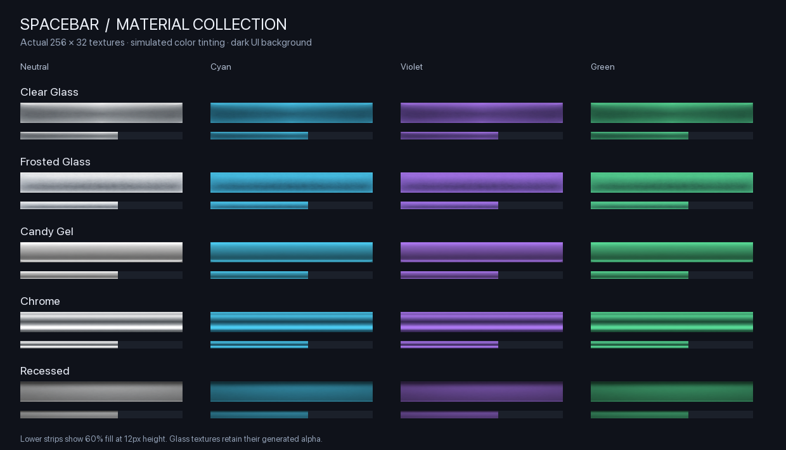

JiberishMedia is a World of Warcraft addon that provides shared media resources for use with LibSharedMedia which is used by many addons. This addon is used by JiberishUI and other various addons like some of my other profile installers.

---

Features
- Supports: **Retail**, **Classic Era**, **Burning Crusade Classic**, and **Mists of Pandaria Classic**
- Contains 24+ custom fonts (Gilroy, RussoOne, Rubik, etc.)
- Includes custom statusbars for UI elements
- Works with **ElvUI**, **EllesmereUI**, and other addons that use LibSharedMedia
- Includes LibStub, CallbackHandler-1.0, and LibSharedMedia-3.0; no other addon is required to register its media

Install the `JiberishMedia` folder in `Interface/AddOns`, enable it, and restart WoW.
Select the fonts and bar textures in your UI addon's settings. In EllesmereUI,
open `/eui` and use the font or bar texture selectors. Installing the pack makes
the media available; it does not change your selected fonts or textures.

Bundled library sources and licenses are listed in `JiberishMedia/Libs/README.md`.

### Spacebar material textures

Five 256×32 statusbar textures are available in LibSharedMedia texture selectors:

- **Spacebar-ClearGlass**: translucent glass with a crisp upper reflection and fine rim lighting.
- **Spacebar-FrostedGlass**: softly frosted glass with diffuse highlights.
- **Spacebar-CandyGel**: a rounded glossy surface with soft depth and a lower reflected highlight.
- **Spacebar-Chrome**: polished metal with contrasting horizontal reflection bands.
- **Spacebar-Recessed**: an inset channel with upper shadow and a thin illuminated lower lip.

The glass textures include alpha transparency; the other three are opaque.
These are static material textures, with no live background blur or refraction.
Restart WoW after adding the files, then select a `Spacebar-` entry in your UI's
bar texture settings. Their neutral tones work with the UI's chosen bar colors.

Artwork was generated with the built-in image tool and exported as uncompressed
32-bit TGA files. Generation prompts are recorded in `artwork/statusbar-materials.json`.

Development checks: run `lua5.1 tests/shared_media.lua` from the repository root.
Branch pushes and pull requests validate and package without uploading. Version
tags continue to use the release workflow.

---

Important Notes
- Join the Discord for Support
- Do *not* upload or redistribute this addon on other websites or addon platforms.
- Do *not* modify and share altered versions of JiberishUI.
- You may use and play with the addon freely for personal in-game use.

---

Community & Support
- Discord: https://discord.gg/jiberish
- Patreon: https://patreon.com/jiberishui
- YouTube: https://www.youtube.com/@jiberishui
- Website: https://jiberishui.com

---

License
All rights reserved.
See LICENSE.md for full details.

© [2025] JiberishUI, LLC – All Rights Reserved
Contact: jiberishui@gmail.com

---

Thank you for supporting custom UI design and the WoW addon community!
